# Microchip PolarFire® SoC FPGA MJPEG Video Streaming Reference Design

<a name="introduction"></a>
## Introduction

This repository contains a PolarFire® SoC FPGA MJPEG video streaming reference design built on Microchip's PolarFire® SoC Video Kit (MPFS250-VIDEO-KIT). The design captures live video from a MIPI CSI2 camera sensor, processes it through a hardware-accelerated video pipeline, compresses it using a JPEG encoder in the FPGA fabric, and streams it over Gigabit Ethernet using RTP protocol.

The design runs RISC-V Linux on the Microprocessor Subsystem (MSS) while leveraging the FPGA fabric for real-time video processing and JPEG compression. A web-based GUI allows users to control the video stream, adjust image parameters, and configure JPEG quality settings. The compressed video can be viewed using standard media players such as VLC, GStreamer, or FFPlay.

<a name="video-processing-pipeline"></a>
### Video Processing Pipeline

The video processing pipeline receives raw Bayer data from the IMX334 camera sensor via MIPI CSI2 interface, performs Bayer-to-RGB conversion, color correction, gamma correction, and image enhancement in real-time. The processed RGB data is then converted to YCbCr color space and fed to the hardware JPEG encoder. Compressed JPEG frames are written to DDR memory via the FIC1 AXI4 interface, where the Linux application reads and streams them over Ethernet.

<a name="key-benefits"></a>
### Key Benefits

- Hardware-accelerated JPEG compression in FPGA fabric for real-time FHD @ 30 FPS
- Web-based GUI for easy stream control and image parameter adjustment
- Standard RTP streaming compatible with VLC, GStreamer, and FFPlay
- Flexible boot options supporting both eMMC and SD card
- Modular IP-based architecture for easy customization

<a name="table-of-contents"></a>
## Table of Contents

- [Microchip PolarFire® SoC FPGA MJPEG Video Streaming Reference Design](#microchip-polarfire-soc-fpga-mjpeg-video-streaming-reference-design)
  - [Introduction](#introduction)
    - [Video Processing Pipeline](#video-processing-pipeline)
    - [Key Benefits](#key-benefits)
  - [Table of Contents](#table-of-contents)
  - [Features](#features)
  - [Demo Requirements](#demo-requirements)
  - [Demo Prerequisites](#demo-prerequisites)
  - [Demo Setup](#demo-setup)
    - [Setting Up the Hardware](#setting-up-the-hardware)
    - [Setting Up the Serial Terminal](#setting-up-the-serial-terminal)
  - [Running the Demo](#running-the-demo)
    - [Flashing Linux .wic Image in eMMC Mode](#flashing-linux-wic-image-in-emmc-mode)
      - [Board Setup](#board-setup)
      - [Entering HSS CLI Mode](#entering-hss-cli-mode)
      - [Flashing the .wic Image](#flashing-the-wic-image)
      - [Booting Linux](#booting-linux)
    - [Flashing Linux .wic Image in SD Card Mode](#flashing-linux-wic-image-in-sd-card-mode)
      - [Board Setup](#board-setup-1)
      - [Flashing the .wic Image to SD Card](#flashing-the-wic-image-to-sd-card)
      - [Booting Linux from SD Card](#booting-linux-from-sd-card)
    - [VLC Configurations](#vlc-configurations)
    - [Running JPEG Demo using GUI](#running-jpeg-demo-using-gui)
  - [Design Overview](#design-overview)
    - [Data Transfers](#data-transfers)
    - [IP Blocks](#ip-blocks)
    - [MSS Configuration](#mss-configuration)
      - [DDR Memory Partition](#ddr-memory-partition)
    - [Clocking Structure](#clocking-structure)
    - [Reset Structure](#reset-structure)
  - [Design Resource Utilization](#design-resource-utilization)
  - [Appendix A: Running the Tcl Script](#appendix-a-running-the-tcl-script)
  - [Appendix B: Programming with FlashPro Express](#appendix-b-programming-with-flashpro-express)
  - [Appendix C: Troubleshooting](#appendix-c-troubleshooting)
    - [Video and Streaming Issues](#video-and-streaming-issues)
    - [Serial and UART Issues](#serial-and-uart-issues)
    - [Network and Ethernet Issues](#network-and-ethernet-issues)
    - [Hardware Setup Issues](#hardware-setup-issues)
  - [Referenced Documents](#referenced-documents)
  - [Documentation and Support](#documentation-and-support)
  - [Glossary](#glossary)

<a name="features"></a>
## Features

The supported features of the JPEG Video Streaming design are as follows:

- **Video Capture and Processing**
  - MIPI CSI2 camera interface supporting FHD (1920x1080) @ 30 FPS
  - Bayer to RGB conversion with bilinear interpolation
  - Color Correction Matrix (CCM) for accurate color reproduction
  - Real-time gamma correction and image enhancement
  - Adjustable brightness, contrast, and color balance controls

- **JPEG Compression**
  - Hardware-accelerated JPEG compression in FPGA fabric
  - Configurable quality factor
  - YUV 4:2:2 color format support
  - FHD (1920x1080) compressed output resolution at 30 FPS

- **Network Streaming**
  - Web-based graphical user interface
  - JPEG RTP streaming over Gigabit Ethernet
  - SDP file generation for media player compatibility
  - Support for VLC, GStreamer, and FFPlay applications

- **Linux Integration**
  - RISC-V Linux running on MSS
  - User-space application for stream control
  - eMMC and SD card boot support

<a name="demo-requirements"></a>
## Demo Requirements

The following table lists the hardware and software components required to run the demo.

<p align="center"><b>Table 1.</b> Demo Requirements</p>

<div align="center">

| Requirement | Description |
|---|---|
| **PolarFire® SoC Video Kit** | [MPFS250-VIDEO-KIT](https://www.microchip.com/en-us/development-tool/MPFS250-VIDEO-KIT) with MPFS250T target device. |
| **Image Sensor Module** | LI-IMX334-MIPI-MICRO v1.0 — provides the MIPI CSI2 camera interface; installs on the Video Kit's camera connector (J10). |
| **USB A to mini-B Cable** | Required for FPGA programming and UART interface. |
| **Power Adapter** | 12V, 5A DC power supply. |
| **Host PC** | A host PC with USB and Ethernet port. |
| **Ethernet Cable** | To communicate with the Video Kit for web GUI and video streaming. |
| **FlashPro Express** | [FlashPro Express](https://www.microchip.com/en-us/products/fpgas-and-plds/fpga-and-soc-design-tools/programming-and-debug) used to program the supplied job file. |
| **Libero® SoC** | [Libero® SoC Design Suite](https://www.microchip.com/en-us/products/fpgas-and-plds/fpga-and-soc-design-tools/fpga/libero-software-later-versions) used to open, modify, and rebuild the design. |
| **PuTTY/TeraTerm/MobaXterm** | Serial terminal application for UART console. |
| **Win32 Disk Imager** | For flashing Linux `.wic` image to SD card or eMMC. |
| **7-zip** | For extracting `.wic` file from `.wic.gz`. |
| **VLC Player** | For MJPEG video playback. |
| **Job File** | `VKPFSOC_MJPEG.job`, packaged into `mpfs250-video-kit-mjpeg_vxxxx.x_Job.zip` is available as assets  on the [GitHub Releases](https://github.com/microchip-fpga-solutions/mpfs250-video-kit-mjpeg/releases) page. |
| **Linux wic Image** | `mchp-base-image-mpfs-video-kit-mjpeg.rootfs-xxxx.xx.wic.gz`, available as assets on the [GitHub Releases](https://github.com/microchip-fpga-solutions/mpfs250-video-kit-mjpeg/releases) page. |

</div>

> **Important:** The Libero® SoC version and complete IP-core version list validated for each release are documented in the release notes on the [GitHub Releases](https://github.com/microchip-fpga-solutions/mpfs250-video-kit-mjpeg/releases) page.

<a name="demo-prerequisites"></a>
## Demo Prerequisites

Before you begin:

1. Confirm that FlashPro Express is installed on the host PC and that the FlashPro programmer is detected by the operating system.
2. Download the packaged archive `mpfs250-video-kit-mjpeg_vxxxx.x_Job.zip` and `mchp-base-image-mpfs-video-kit-mjpeg.rootfs-xxxx.xx.wic.gz` for this release from the [GitHub Releases](https://github.com/microchip-fpga-solutions/mpfs250-video-kit-mjpeg/releases) page . Extract the programmin job file (`VKPFSOC_MJPEG.job`) and the Linux `.wic` image
 See [Appendix B: Programming with FlashPro Express](#appendix-b-programming-with-flashpro-express).
3. Download and install the latest versions of the following software utilities:
   - Serial communicator applications like TeraTerm, PuTTY, or MobaXterm
   - Win32 Disk Imager or [USB Imager](https://gitlab.com/bztsrc/usbimager)
   - 7-zip
   - VLC Player
4. Obtain the Image Sensor Module (LI-IMX334-MIPI-MICRO) and install it on the Video Kit's camera connector (J10) before applying power.
5. If UART diagnostics are required, configure a serial terminal for 115200 baud, 8 data bits, no parity, 1 stop bit, and no flow control.

<a name="demo-setup"></a>
## Demo Setup

To set up the demo, follow these steps:

1. Set up the hardware.
2. Set up the serial terminal.
3. Program the device — see [Appendix B: Programming with FlashPro Express](#appendix-b-programming-with-flashpro-express).

<a name="setting-up-the-hardware"></a>
### Setting Up the Hardware

<p align="center">
  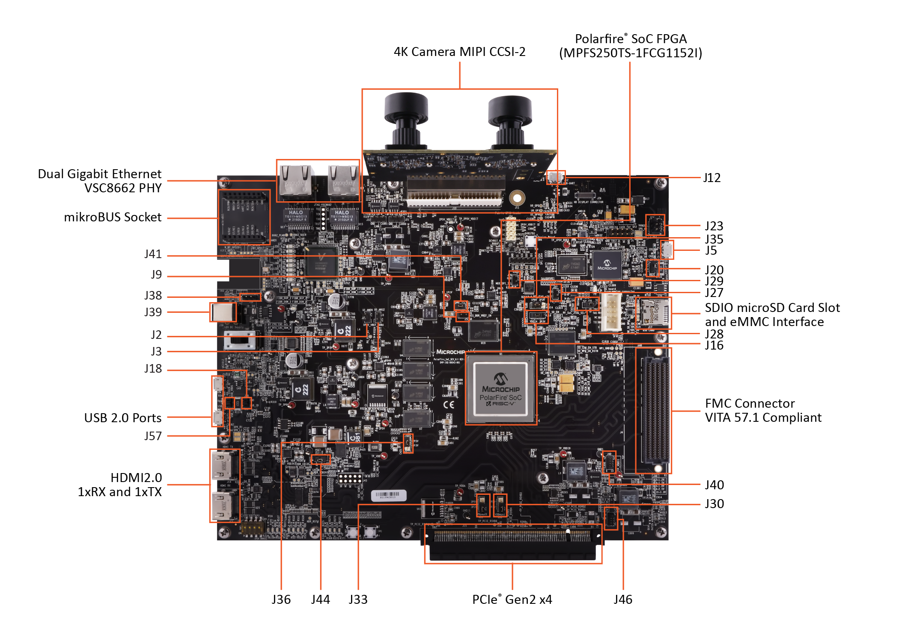
</p>
<p align="center"><b>Figure 1.</b> PolarFire® SoC Video Kit (MPFS250-VIDEO-KIT)</p>

To set up the hardware, perform the following steps:

1. Connect the camera sensor module at **J10** on the Video Kit.
2. Ensure the jumper settings on the Video Kit are configured as listed in the following table.

<div>
  <p align="center"><b>Table 2.</b> Jumper Settings</p>
<div align="center">

| Jumper/Connector | Default Position | Functionality |
| :---: | :---: | :--- |
| J5 | - | FPGA programming (Micro-USB) |
| J6 | - | Ethernet GEM0 (RJ45) - IP: 192.168.2.1 |
| J10 | - | Camera sensor module connector |
| J12 | - | UART connection (Micro-USB) |
| J19 | - | eMMC flashing (Micro-USB) |
| J46 | 9 and 10 | Bank 1 voltage for CAN testing |
| J40 | 9 and 10 | Bank9 voltage |
| J16 and J35 | 2 and 3 | 1.8V for eMMC booting |
| J36 | 1 and 2 | VDDAUX4 |
| J2 and J3 | Open | DDR4 ref voltage |
| J20 | 1 and 2 | VBUS for FP6 |
| J23 | 1 and 2 | Backlight LED driver VANODE |
| J29 | Open | SPI Flash |
| J27 | Open | JTAG TRSTB |
| J39 | 12V Input | 12V input to Board |
| J28 | 1 and 2 | eFP6 programmer |
| J41 | 1 and 2 | 125 MHz output |
| J9 | Open | MSS DDR Vref |
| J33 | 1 and 2 | VDDAUX9 |
| J30 | 1 and 2 | VDDAUX1 |
| J38 | Open | WiFi chip I2C CLK and data |
| J18 and J57 | Open | USB ID |
| J44 | 1 and 2 | Core voltage 1.05V |

</div>
</div>

<a name="setting-up-the-serial-terminal"></a>
### Setting Up the Serial Terminal

The PolarFire® SoC Video Kit includes a CP2108 USB to UART chip to interact with the on-board Linux OS. CP2108 drivers can be downloaded from [here](https://www.silabs.com/developers/usb-to-uart-bridge-vcp-drivers).

After installing the driver, follow these steps:

1. Connect USB cable at **J12** port on the PolarFire® SoC Video Kit board to the host PC.
2. After connecting the power adapter to the board at **J39**, switch **ON** the board's power supply using the **SW5** switch. This should detect the USB UART chip on the board at the host PC. You can confirm this in the host PC device manager.

<p align="center">
  
</p>
<p align="center"><b>Figure 2.</b> Device Manager - COM Ports</p>

The following table lists the serial port interfaces available on the CP2108 USB to UART bridge.

<div>
  <p align="center"><b>Table 3.</b> Serial Port Interfaces</p>
<div align="center">

| Interface | Description |
| :--- | :--- |
| Interface 0 | HSS Boot Messages and CLI |
| Interface 1 | Linux Console (U54_1) |
| Interface 2 | Reserved |
| Interface 3 | Reserved |

</div>
</div>

3. An application like **PuTTY/MobaXterm/TeraTerm** at the host PC is required to establish serial communication with the Video Kit board. Configure the serial port settings as shown below.

<p align="center">
  
</p>
<p align="center"><b>Figure 3.</b> Serial Port Settings (PuTTY)</p>

<div>
  <p align="center"><b>Table 4.</b> Serial Port Configuration</p>
<div align="center">

| Parameter | Value |
| :--- | :--- |
| Speed (bps) | 115200 |
| Data bits | 8 |
| Stop bits | 1 |
| Parity | None |
| Flow control | Xoff |

</div>
</div>

> **Note:** The data rate must be configured for all interfaces to establish successful communication with the PolarFire® SoC Video Kit.

<a name="running-the-demo"></a>
## Running the Demo

The Linux `.wic` image is packaged with all the demo applications. Extract the `mchp-base-image-mpfs-video-kit-mjpeg.rootfs-xxxx.xx.wic.gz` with the 7-zip utility to any folder. The extracted `.wic` image can be flashed either in eMMC or SD card. Regardless of the flashing device, running the demo user applications remains the same.

<a name="flashing-linux-wic-image-in-emmc-mode"></a>
### Flashing Linux .wic Image in eMMC Mode

This section describes the steps to put the HSS in CLI mode, program the Linux images into eMMC using the Win32DiskImager application, and initiate the Linux boot.

#### Board Setup

1. Do not insert an SD card into the board. If present, SD card booting takes priority.
2. Remove the micro-USB cable connected to **J5** and connect it to **J19** of the board. When the USB cable is detected, the LED near J19 glows green.
3. Connect one more micro-USB cable to **J12** from the host PC.
4. **J16** and **J35** must be connected to pins 2 and 3 (for 1.8V).
5. **J44** must be connected to pins 1 and 2 (for 1.05V).
6. **J18** and **J57** must be open.
7. Power ON the board.

#### Entering HSS CLI Mode

8. Open the serial terminal application (PuTTY/MobaXterm) and select the COM port corresponding to **Interface 0** (e.g., COM25).
9. Press **Enter** on Interface 0 while the board is booting to enter HSS CLI mode.
10. Type the `usbdmsc` command on the HSS prompt. The board will be in eMMC mode once the eMMC is passed.

<p align="center">
  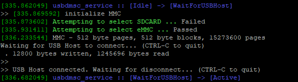
</p>
<p align="center"><b>Figure 4.</b> Executing the usbdmsc Command</p>

#### Flashing the .wic Image

11. Open **Win32DiskImager** on the host PC and browse to select the extracted `.wic` file.
12. Check the **Safely Remove Hardware** icon in the system tray and note the drive letter assigned to the eMMC boot partition.

<p align="center">
  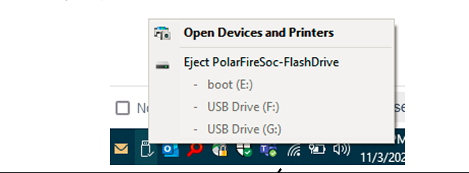
</p>
<p align="center"><b>Figure 5.</b> Drive Eject Options</p>

13. In Win32DiskImager, select the eMMC boot device from the **Device** dropdown.
14. Click **Write**. A confirm overwrite dialog box appears.

<p align="center">
  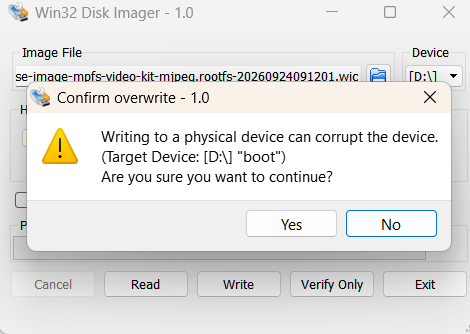
</p>
<p align="center"><b>Figure 6.</b> Confirm Overwrite</p>

15. Click **Yes** to confirm. The writing process begins and takes a couple of minutes to complete.

<p align="center">
  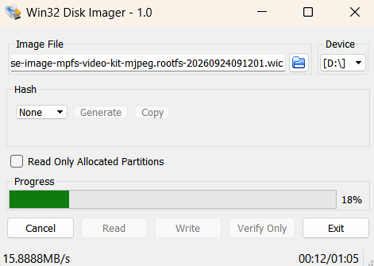
</p>
<p align="center"><b>Figure 7.</b> Writing In-progress</p>

16. Once the write completes successfully, click **Exit** in Win32DiskImager.
17. Safely eject the eMMC drive from the system tray.
18. Disconnect the USB cable from the **J19** USB-UART connector on the kit.

#### Booting Linux

19. On the HSS CLI (Interface 0), type the `boot` command.
20. Switch to **Interface 1** in your serial terminal. Linux will boot and display the login prompt.

<p align="center">
  
</p>
<p align="center"><b>Figure 8.</b> Linux User Login</p>

<a name="flashing-linux-wic-image-in-sd-card-mode"></a>
### Flashing Linux .wic Image in SD Card Mode

This section describes the steps for flashing the Linux `.wic` image to an SD card and booting from it.

#### Board Setup

1. Power OFF the board.
2. Connect a micro-USB cable to **J12** from the host PC.
3. **J16** and **J35** must be connected to pins 2 and 3 (for 1.8V).
4. **J44** must be connected to pins 1 and 2 (for 1.05V).
5. **J18** and **J57** must be open.
6. Do NOT connect any cable to **J19**.

#### Flashing the .wic Image to SD Card

7. Insert an SD card into the host PC SD card reader.
8. Open **Win32DiskImager** on the host PC and browse to select the extracted `.wic` file.
9. Check the **Safely Remove Hardware** icon in the system tray and note the drive letter assigned to the SD card.
10. In Win32DiskImager, select the SD card device from the **Device** dropdown.
11. Click **Write**. A confirm overwrite dialog box appears.
12. Click **Yes** to confirm. The writing process begins and takes a couple of minutes to complete.
13. Once the write completes successfully, click **Exit** in Win32DiskImager.
14. Safely eject the SD card from the system tray and remove it from the host PC.

#### Booting Linux from SD Card

15. Insert the SD card into the SD card slot (**J23**) on the PolarFire® SoC Video Kit.
16. Power ON the board.
17. Open the serial terminal and connect to **Interface 1**. Linux will boot automatically and display the login prompt.

> **Note:** When an SD card is present, the board boots from the SD card by default, taking priority over eMMC.

<a name="vlc-configurations"></a>
### VLC Configurations

Launch the VLC media player and configure the following for JPEG streaming:

1. **Disable hardware acceleration**:
   - In the **Simple Preferences** window, click the **Input / Codecs** tab and set **Hardware-accelerated decoding** to **Disable**.

<p align="center">
  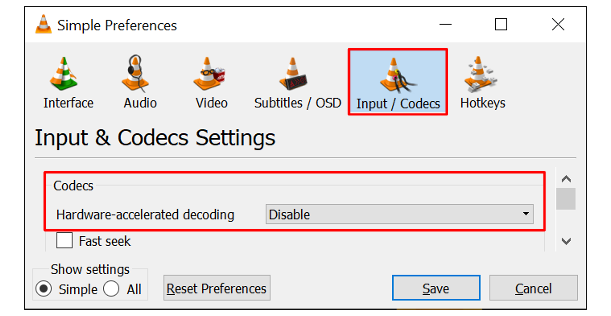
</p>
<p align="center"><b>Figure 9.</b> Simple Preferences - Input / Codecs</p>

2. **Alter the Network Caching**:
   - In the VLC media player menu bar, select **Tools** > **Preference**.
   - Select **All** under **Show settings** for Advanced Preferences.
   - In the **Advanced Preferences** window, select **Input / Codecs** and alter the **Network Caching (ms)** if the file you are trying to play is located on a network share.

<p align="center">
  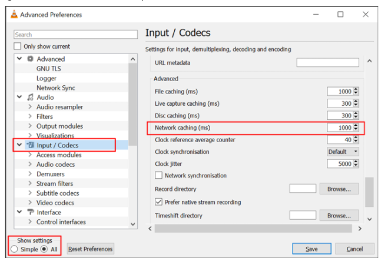
</p>
<p align="center"><b>Figure 10.</b> Advanced Preferences - Input / Codecs</p>

3. **Configure the video output module**:
   - Select **Video** > **Output modules** and set **Video output module** to **Windows GDI video output**.

<p align="center">
  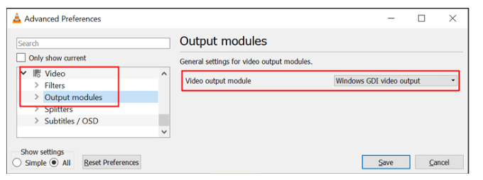
</p>
<p align="center"><b>Figure 11.</b> Advanced Preferences - Video Output Modules</p>

4. Click **Save**.

<a name="running-mjpeg-demo-using-gui"></a>
### Running JPEG Demo using GUI

To run the JPEG Demo using GUI, follow these steps:

1. Insert the dual-camera sensor module in **J10** on the PolarFire® SoC Video Kit. Ensure to remove the camera lens cap.

2. Do not connect any Ethernet cable from the host to the Video Kit initially.

3. On the Windows host, open command prompt in Admin mode and type `ipconfig`.

4. Note down the name of the Ethernet adapter displayed against the **Media disconnected** interface.

5. Connect an Ethernet cable from Video Kit **eth0** port to the PC Ethernet port. The Ethernet port **eth0** is next to the camera mount.

6. On command prompt, type `ipconfig`. It should report an IP address, which indicates the Ethernet port is working and connected. The following figure shows the ipconfig command output with Ethernet port status.

<p align="center">
  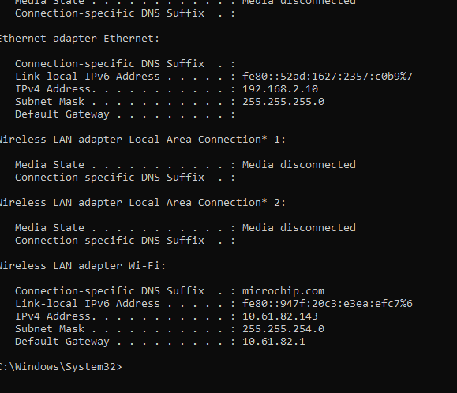
</p>
<p align="center"><b>Figure 12.</b> Executing the ipconfig Command and Fetching the Ethernet Port Status</p>

7. Set the host IP address to `192.168.2.X` (where X is any integer from 2 to 255) and the Subnet mask to `255.255.255.0` using the following command. This is a one-time process:
   ```
   netsh interface ip set address "Ethernet" static 192.168.2.10 255.255.255.0
   ```

<p align="center">
  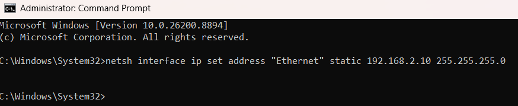
</p>
<p align="center"><b>Figure 13.</b> Setting the Host IP Address</p>

8. Check if the connection is successful by pinging the Video Kit:
   ```
   ping 192.168.2.1
   ```

<p align="center">
  
</p>
<p align="center"><b>Figure 14.</b> Pinging the Video Kit from Command Prompt</p>

9. Default IP addresses of the board are **192.168.2.1** (J6) and **192.168.2.2** (J7) based on the interface. Ensure that the host PC is in the same network.

10. Power ON the board and wait for the system boot sequence to complete. **LED3** glows green once the Linux boot-up sequence is completed. Restart the board if LED3 does not glow.

11. On the Video Kit Linux terminal, check the IP address using `ifconfig` command:
    ```bash
    ifconfig
    ```
    Note the IP address shown for **eth0** (e.g., 192.168.2.10).

12. Verify the connection between host PC and Video Kit by pinging from both sides:
    - From **Host PC**: `ping 192.168.2.1` (use the board IP)
    - From **Video Kit terminal**: `ping 192.168.2.10` (host PC IP)

13. From the host PC, open the web browser. Enter the IP address shown in `ifconfig` (e.g., **192.168.2.1**) in the address bar and press **Enter**. The MJPEG demonstration GUI loads in the browser.

<p align="center">
  
</p>
<p align="center"><b>Figure 15.</b> MJPEG Demonstration GUI</p>

The GUI provides the following controls:
- **Brightness**: Adjusts the image brightness level
- **Contrast**: Adjusts the image contrast level
- **Quality Factor**: Sets the JPEG compression quality (higher value = better quality, larger file size)
- **Color Balance (Red/Green/Blue)**: Adjusts individual color channel gains
- **Update**: Applies the slider settings to the video stream
- **Start Video / Stop Video**: Starts or stops the video streaming
- **SDP file**: Downloads the SDP file for VLC player configuration

14. Click **Start Video** to initiate the video streaming.

15. Click the **SDP file** button on the GUI to download the SDP file to your host PC.

16. Play the video stream using one of the following media players:
    - **VLC Player**: Open VLC, go to **Media** > **Open File**, select the downloaded SDP file
    - **FFPlay**: Open the downloaded SDP file using FFPlay application
    - **GStreamer**: Use GStreamer pipeline to receive the RTP stream on port 5004

17. Observe a live stream video captured from one of the cameras in the PolarFire® SoC Video Kit. This is a JPEG compressed video of FHD (1920x1080) resolution at 30 FPS.

<a name="design-overview"></a>
## Design Overview

This section provides a description of the design.

<p align="center">
  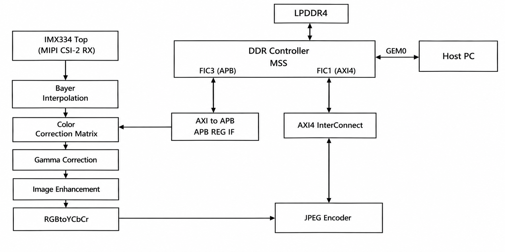
</p>
<p align="center"><b>Figure 16.</b> Design Overview</p>

The above diagram illustrates a simple JPEG base (compact) design where a single driver is used to control all IP cores in the video processing pipeline.

A modular pipeline architecture for JPEG video processing using IP cores in the fabric provides significant flexibility and control over the video processing workflow. Each IP core performs a specific function in the JPEG encoding process and has its own driver, with the pipeline connecting these cores defined through the device tree.

This modular approach allows for a high degree of customization, scalability, and reusability, as each core can be independently developed, tested, and updated.

<a name="data-transfers"></a>
### Data Transfers

The following describes the memory scheme used in the design for data transfers:

<p align="center">
  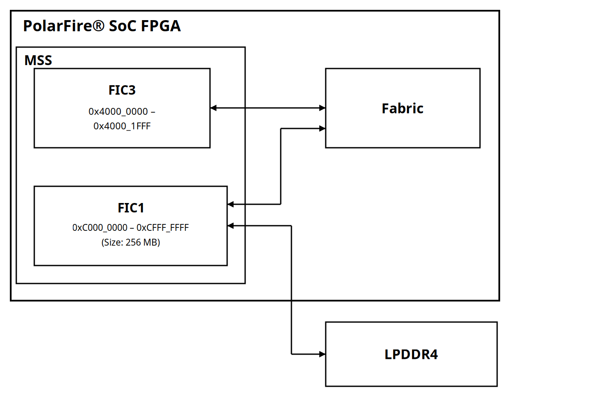
</p>
<p align="center"><b>Figure 17.</b> PolarFire® SoC FPGA Data Flow</p>

**PolarFire® SoC FPGA Data Flow:**
- **MSS** communicates with **Fabric** through:
  - **FIC3** (0x4000_0000 – 0x4000_1fff): APB interface for control registers
  - **FIC1** (0xC000_0000 – 0xCFFF_FFFF): AXI4 interface for compressed data transfer to DDR (Non-Cached 256MB region)
- **Fabric** interfaces with **DDR** for video frame storage

Compressed data is read from the FIC1 as per the node size (current demo has a node size of 256 KB). This data is passed on to the FFMPEG framework, which converts the data into RTP packets to send over the GEM.

<a name="ip-blocks"></a>
### IP Blocks

The following table lists the IP blocks used in the design and their functionality.

<div>
  <p align="center"><b>Table 5.</b> IP Blocks</p>
<div align="center">

| IP Block | Description |
| :--- | :--- |
| Bayer_Interpolation | Converts 8-bit raw Bayer data to 24-bit RGB data |
| CAM_IOD_TIP_TOP | Camera IOD timing and interface control |
| CLOCKS_AND_RESETS | Clock generation and reset synchronization module |
| Color_Correction_Matrix | Applies 3x3 matrix transformation for accurate color reproduction |
| CoreAPB3 | APB3 bus interface for peripheral communication |
| CORERESET_PF | Synchronizes reset signals to respective clock domains |
| CORERXIODBITALIGN | IOD bit alignment for camera data reception |
| DDR_AXI4_ARBITER_PF | Arbitrates DDR4 memory access for write operations |
| FIC_CONVERTER | Fabric Interface Controller converter |
| Gamma_Correction | Converts pixel intensity using logarithmic curve |
| Image_Enhancement | Adjusts brightness, contrast, and color balance |
| IMX334_IF_TOP | Receives live camera feed via MIPI CSI2 and converts to parallel data |
| INIT_MONITOR | Monitors device initialization and triggers reset |
| JPEG_Encoder | JPEG compression core |
| JPEG_top | JPEG encoder and DDR write controller |
| mipicsi2rxdecoderPF | MIPI CSI2 receiver decoder for sensor interface |
| MJPEG_DDR_WRITE | DDR write controller for MJPEG compressed data |
| MSS_JPEG | Microprocessor Subsystem for MJPEG Video Kit |
| PF_CCC | Clock Conditioning Circuitry for clock generation |
| PF_CLK_DIV | Clock divider block |
| PF_IOD_GENERIC_RX | Generic IOD receiver operating at 1200 Mbps |
| PF_OSC | RC Oscillator generating 2 MHz clock |
| PF_XCVR_REF_CLK | Transceiver reference clock |
| RGBtoYCbCr | Color space conversion from RGB 24-bit to YUV422 |

</div>
</div>

<a name="mss-configuration"></a>
### MSS Configuration

The following table lists the configuration of MSS clock, peripherals, and memory.

<div>
  <p align="center"><b>Table 6.</b> MSS Configuration</p>
<div align="center">

| MSS Block | Description |
| :--- | :--- |
| MSS Clocks | MSS PLL reference clock source: 125 MHz<br>MSS CPU clock frequency: 600 MHz |
| Peripherals | eMMC: Used for storing Linux kernel images<br>Gigabit Ethernet MAC: Used for copying data to/from Linux OS to host PC<br>MMUART: Used to capture HSS boot and Linux terminal<br>I2C: Used for initializing the camera<br>FIC1 AXI4 slave interface for accessing LPDDR4 |
| DDR Memory | LPDDR4 with the default configuration |

</div>
</div>

#### DDR Memory Partition

PolarFire® SoC Video Kits come with 2 GB of DDR memory by default, partitioned as follows:

<p align="center">
  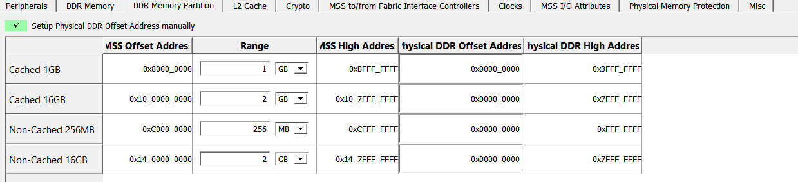
</p>
<p align="center"><b>Figure 18.</b> DDR Memory Partition</p>

The DDR memory regions are configured as shown in the preceding figure:

<div>
  <p align="center"><b>Table 7.</b> DDR Memory Regions</p>
<div align="center">

| Region | MSS Offset Address | Range | MSS High Address | Physical DDR Offset | Physical DDR High |
| :--- | :---: | :---: | :---: | :---: | :---: |
| Cached 1GB | 0x8000_0000 | 1 GB | 0xBFFF_FFFF | 0x0000_0000 | 0x3FFF_FFFF |
| Cached 16GB | 0x10_0000_0000 | 2 GB | 0x10_7FFF_FFFF | 0x0000_0000 | 0x7FFF_FFFF |
| Non-Cached 256MB | 0xC000_0000 | 256 MB | 0xCFFF_FFFF | 0x0000_0000 | 0xFFF_FFFF |
| Non-Cached 16GB | 0x14_0000_0000 | 2 GB | 0x14_7FFF_FFFF | 0x0000_0000 | 0x7FFF_FFFF |

</div>
</div>

> **Note 1:** Range selection for any Cached or Non-Cached memory region must be a multiple of 16 MB.

> **Note 2:** Memory is not allocated in DDR when Range is set to 0.

<a name="clocking-structure"></a>
### Clocking Structure

<p align="center">
  
</p>
<p align="center"><b>Figure 19.</b> Clock Structure</p>

The following table lists the clocks used in the design.

<div>
  <p align="center"><b>Table 8.</b> Clock Sources</p>
<div align="center">

| Clock Source | Frequency | Description |
| :--- | :---: | :--- |
| 27 MHz Oscillator on Camera Module | 27 MHz | Provides MIPI RX clock (CAM1_RX_CLK_P/N) to IMX334_IF_TOP_0 |
| 148.5 MHz On-board Oscillator | 148.5 MHz | Input to PF_XCVR_REF_CLK_C0, then to PF_CCC_C0 for clock generation |
| 2 MHz Internal RC Oscillator | 2 MHz | PF_OSC_C0 provides clock to PF_CLK_DIV_C0 |

</div>
</div>

The PF_CCC_C0 generates the following output clocks from the 148.5 MHz reference:
- **125 MHz (OUT0_FABCLK_0)**: Drives JPEG_top_0 (fic_clk), MSS_FIC_1, DDR_AXI4_ARBITER
- **50 MHz (OUT1_FABCLK_0)**: Drives apb3_if_0, IMX334_IF_TOP_0 (ACLK_I), JPEG_top_0 (apb_clk), FIC_CONVERTER_0, MSS_FIC_3

The IMX334_IF_TOP_0 contains PF_CCC_C2 which generates:
- **PARALLEL_CLOCK**: Derived from camera RX clock, drives video_pipeline_1 (Bayer_Interpolation, Color_Correction_Matrix, Gamma_Correction, Image_Enhancement), JPEG_top_0 (sys_clk_i), RGBtoYCbCr_C0_0, frame_controls_gen_0

The MSS I2C interface uses the 150 MHz MSS peripheral clock for camera control via I2C_0.

<a name="reset-structure"></a>
### Reset Structure

<p align="center">
  
</p>
<p align="center"><b>Figure 20.</b> Reset Structure</p>

The INIT_MONITOR IP asserts the following signals:

- **FABRIC_POR_N**: Asserted after the initialization of the fabric
- **DEVICE_INIT_DONE**: Asserted after the initialization of the entire PolarFire® SoC device

The design uses two main CORERESET blocks in CLOCKS_AND_RESETS:

| Reset Block | Output Signal | Description |
| :--- | :--- | :--- |
| CORERESET_CLK_125MHz | RESETN_125MHz | Resets all blocks operating at 125 MHz |
| CORERESET_CLK_50MHz | RESETN_50MHz | Resets all blocks operating at 50 MHz |

Additionally, inside IMX334_IF_TOP_0:

| Reset Block | Output Signal | Description |
| :--- | :--- | :--- |
| CORERESET_PF_C1_0 | CAMCLK_RESET_N | Resets camera clock domain (PARALLEL_CLOCK) |
| CORERESET_PF_C2_0 | CAMIF_RESET_N | Resets camera interface logic and data path |

The PLL_LOCK signal from PF_CCC_C0 and MSS_PLL_LOCKS are combined with MSS_RESET_N_M2F to generate the reset inputs (EXT_RST_N, PLL_LOCK, INIT_DONE, FPGA_POR_N) to the CORERESET blocks.

<a name="design-resource-utilization"></a>
## Design Resource Utilization

The resource utilization of the JPEG Video Streaming design includes the following major modules:

<div>
  <p align="center"><b>Table 9.</b> Per-Module Resource Utilization</p>
<div align="center">

| Module Name | Fabric 4LUT | Fabric DFF | uSRAM (64x12) | LSRAM (20K) | Math (18x18) |
| :--- | :---: | :---: | :---: | :---: | :---: |
| CLOCKS_AND_RESETS_inst_0 | 2 | 33 | 0 | 0 | 0 |
| FIC_CONVERTER_0 | 35 | 0 | 0 | 0 | 0 |
| IMX334_IF_TOP_0 | 5312 | 4879 | 0 | 11 | 0 |
| JPEG_top_0 | 6967 | 3876 | 7 | 81 | 34 |
| RGBtoYCbCr_C0_0 | 106 | 72 | 0 | 0 | 9 |
| Bayer_Interpolation_C0_0 | 856 | 451 | 0 | 3 | 0 |
| Gamma_Correction_C0_0 | 465 | 22 | 0 | 0 | 0 |
| Color_Correction_Matrix_C0_0 | 312 | 185 | 0 | 0 | 9 |
| Image_Enhancement_C0_0 | 169 | 241 | 0 | 0 | 3 |
| apb3_if_0 | 91 | 141 | 0 | 0 | 0 |
| **Total (Fabric)** | **14315** | **9900** | **7** | **95** | **55** |

</div>
</div>

<a name="appendix-a-running-the-tcl-script"></a>
## Appendix A: Running the Tcl Script

TCL scripts are provided in the `hw` folder of this repository. If required, the design flow can be reproduced from Design Implementation before the job file is generated.

To run TCL, follow these steps:

1. Launch the Libero software.
2. Select **Project** > **Execute Script...**.
3. Click **Browse** and select `script.tcl` from the `hw` folder.
4. Click **Run**.

After successful execution of the TCL script, the Libero project is created within the `hw` folder.

> **Note:** IP-core versions are declared in one place: [`hw/common/common.tcl`](hw/common/common.tcl). Consult the [GitHub Releases](https://github.com/microchip-fpga-solutions/mpfs250-video-kit-mjpeg/releases) page for the validated Libero® SoC version and IP core version list specific to each release.

See the [*Libero® SoC Tcl Command Reference Guide*](https://onlinedocs.microchip.com/v2/keyword-lookup?keyword=fpgasoctcl&redirect=true) for more information about Tcl commands. Contact Technical Support [here](https://www.microchip.com/support) for any queries about running the Tcl script.

<a name="appendix-b-programming-with-flashpro-express"></a>
## Appendix B: Programming with FlashPro Express

This appendix describes how to program the PolarFire® SoC device with the `VKPFSOC_MJPEG.job` file using FlashPro Express. Download the job file from the GitHub Releases page [here](https://github.com/microchip-fpga-solutions/mpfs250-video-kit-mjpeg/releases).

To program the device, perform the following steps:

1. Connect a micro USB to **J5** from the host PC and start the FlashPro Express software from its installation directory.

2. Select **New** or **New Job Project from FlashPro Express Job** from the **Project** menu to create a new job project.

3. In the **New Job Project from FlashPro Express Job** dialog box, enter the following:
   - **Programming job file**: Click **Browse**, navigate to the location where the job file (`VKPFSOC_MJPEG.job`) was downloaded from the [GitHub Releases](https://github.com/microchip-fpga-solutions/mpfs250-video-kit-mjpeg/releases) page, and select the file.
   - **FlashPro Express job project location**: Select **Browse** and navigate to the location where you want to save the project.

4. Click **Open**. The required programming file is selected and ready to be programmed in the device. The FlashPro Express window appears. Confirm that a programmer number appears in the **Programmer** field. If it does not, check the board connections and click **Refresh/Rescan Programmers**.

5. Click **RUN** to program the device. When the device is programmed successfully, a **RUN PASSED** status is displayed.

6. Close FlashPro Express (**Project** > **Exit**).

7. Power-cycle the board.

<a name="appendix-c-troubleshooting"></a>
## Appendix C: Troubleshooting

This section provides solutions to common issues that may occur while running the demo.

### Video and Streaming Issues

- **No video stream in VLC Player**
  - Verify the camera module is properly connected at **J10**
  - Ensure the camera lens cap is removed
  - Check that the camera driver initialization completed successfully
  - Verify the Ethernet connection between the host PC and Video Kit
  - Confirm the SDP file has the correct IP address and port

- **Video stream is choppy or has artifacts**
  - Reduce the network caching value in VLC settings
  - Ensure no other applications are using significant network bandwidth
  - Check the Ethernet cable connection

### Serial and UART Issues

- **COM ports not appearing in Device Manager**
  - Reseat the USB cable at **J12**
  - Install or reinstall the CP2108 USB to UART drivers from Silicon Labs
  - Try a different USB port on the host PC

- **No output on serial terminal**
  - Verify the correct COM port is selected (Interface 0 for HSS, Interface 1 for Linux)
  - Confirm baud rate is set to **115200 bps**
  - Check serial settings: 8 data bits, 1 stop bit, no parity, flow control off

- **Garbled characters on serial terminal**
  - Verify baud rate is exactly **115200 bps**
  - Check that data bits, stop bits, and parity settings are correct

### Network and Ethernet Issues

- **Cannot ping the Video Kit**
  - Verify the Ethernet cable is connected to **J6** or **J7**
  - Ensure the host PC IP address is in the same subnet (192.168.2.x)
  - Check that the Video Kit has booted successfully (LED3 should be green)
  - Run the IP configuration commands on the Video Kit terminal

- **Web GUI not loading in browser**
  - Verify the IP address entered matches the connected Ethernet port (J6: 192.168.2.1, J7: 192.168.2.2)
  - Disable any firewall or VPN that may block the connection
  - Try a different web browser

### Hardware Setup Issues

- **Board not powering on**
  - Verify the 12V power adapter is connected at **J39**
  - Check that **SW5** power switch is in the ON position
   - Ensure jumper settings match the configuration in Table 2

- **eMMC not detected during flashing**
  - Verify USB cable is connected to **J19** (not J5)
  - Ensure the `usbdmsc` command was executed successfully on HSS CLI
  - Check that no SD card is inserted in the board

- **Linux boot fails**
  - Verify the .wic image was written successfully without errors
  - Check jumper settings for **J16**, **J35**, and **J44**
  - Try re-flashing the .wic image

<a name="referenced-documents"></a>
## Referenced Documents

<div>
  <p align="center"><b>Table 10.</b> Referenced Documents</p>
<div align="center">

| Document | Description |
| :--- | :--- |
| [MPFS250-VIDEO-KIT Product Page](https://www.microchip.com/en-us/development-tool/MPFS250-VIDEO-KIT) | PolarFire® SoC Video Kit product information and documentation |
| [Libero® SoC Tcl Command Reference Guide](https://onlinedocs.microchip.com/v2/keyword-lookup?keyword=fpgasoctcl&redirect=true) | TCL command reference for Libero® SoC Design Suite |
| [PolarFire® SoC FPGA Family Product Page](https://www.microchip.com/en-us/products/fpgas-and-plds/system-on-chip-fpgas/polarfire-soc-fpgas) | PolarFire® SoC FPGA family overview and resources |

</div>
</div>

<a name="documentation-and-support"></a>
## Documentation and Support

- **Microchip FPGA Support**: Contact the Technical Support Center [here](https://www.microchip.com/support). Mention the FPGA Device Part number, select an appropriate case category, and upload design files while creating a technical support case.

- **Customer Service** (non-technical product support): From North America, call **800.262.1060**. From the rest of the world, call **650.318.4460**. Fax, from anywhere in the world, **650.318.8044**.

<a name="glossary"></a>
## Glossary

| Term | Definition |
| :--- | :--- |
| **AXI4** | Advanced eXtensible Interface version 4 — AMBA bus protocol for high-performance interconnects |
| **Bayer** | A color filter array pattern used in digital image sensors to create color images |
| **CCC** | Clock Conditioning Circuit — Microchip FPGA primitive that generates and phase-aligns derived clocks |
| **DDR4** | Double Data Rate 4 — Fourth-generation DDR memory standard |
| **eMMC** | Embedded Multi-Media Card — flash storage standard for embedded systems |
| **FIC** | Fabric Interface Controller — interface between MSS and FPGA fabric |
| **FFMPEG** | Fast Forward MPEG — multimedia framework for handling video, audio, and other multimedia files |
| **FPS** | Frames Per Second |
| **GEM** | Gigabit Ethernet MAC — Ethernet media access controller |
| **HSS** | Hart Software Services — boot loader for PolarFire® SoC |
| **I2C** | Inter-Integrated Circuit — serial communication bus |
| **JPEG** | Joint Photographic Experts Group — image compression standard |
| **LPDDR4** | Low Power DDR4 — low-power variant of DDR4 memory |
| **MIPI CSI2** | Mobile Industry Processor Interface Camera Serial Interface 2 |
| **MJPEG** | Motion JPEG — video compression format where each frame is a JPEG image |
| **MMUART** | Multi-Mode UART — configurable serial communication interface |
| **MSS** | Microprocessor Subsystem — the RISC-V processor complex in PolarFire® SoC |
| **PLL** | Phase-Locked Loop |
| **RGB** | Red, Green, Blue — color model |
| **RISC-V** | Open-source instruction set architecture |
| **RTP** | Real-time Transport Protocol — network protocol for delivering audio/video over IP |
| **SDP** | Session Description Protocol — format for describing streaming media sessions |
| **UART** | Universal Asynchronous Receiver-Transmitter |
| **VLC** | VideoLAN Client — open-source multimedia player |
| **WCB** | Write Combining Buffer — memory optimization technique |
| **YUV422** | Color space with chroma subsampling — Y (luminance), U and V (chrominance) |
